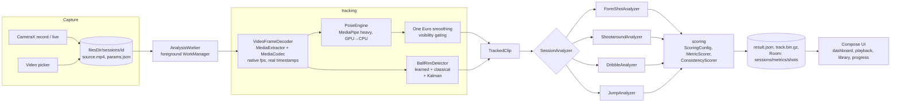

# FormCheck

An Android app that measures basketball shooting form, shootaround makes and misses, dribbling
drills and vertical jump from your own video. Everything runs on the phone; the app has no
internet permission and no video leaves the device.

## Ground rules the app follows

- **No made-up numbers.** Every value comes from a measurement on your footage.
- **If it can't be measured, it says so.** "Not measured" plus a one-line reason (wrong camera
  angle, joint hidden, ball not tracked, no scale…), never a guess.
- **Every metric carries its evidence:** value, unit, confidence, and the frames it came from. Tap
  any metric to jump to that frame with the angle drawn on the video.
- **Targets say where they come from.** One is physics, one is commercial shot-tracking data, and
  the rest are labelled as coaching convention or app heuristic (`ScoringConfig`). The overall score
  averages only measured metrics and shows "from N of M".

## Modes

| Mode | What you get |
|---|---|
| **Form shot** | Knee bend, elbow at set point and release, elbow alignment (front view), guide hand, trunk lean, release height, release angle, arc apex, entry angle (rim visible), dip-to-release timing, follow-through hold, balance and landing drift, jump height. Consistency across shots in the clip. |
| **Shootaround** | Live or recorded. Attempts, makes, misses, Uncertain (correct it with one tap), FG% overall and by zone, shot chart from a one-time court calibration, makes vs misses comparison, longest streak, full form dashboard per shot. |
| **Dribbling** | Drill library. Stance height vs your standing hip height, knee angle, dribble height vs the drill target, ball protection (proxy), rhythm variation, fumbles, eyes up (proxy), pace, per-hand counts, drill-pattern accuracy. Live voice cues. |
| **Vertical jump** | Flight-time jump height (h = g·t²/8) cross-checked with hip rise, landing-form check, countermovement depth, takeoff velocity, front-view takeoff symmetry, best of attempts, personal best, optional max-reach estimate. Records at 120/240 fps when the phone supports it. |

Also: Library (thumbnails, filter, rename, delete, storage used), playback with toggleable
skeleton / ball trail / angle labels, 0.25× and 0.5× slow motion and frame stepping, annotated
MP4 export, camera setup guide, progress trends and personal bests, weekly goals and streaks,
drill recommendations, best vs worst shot side by side.

## Which camera angle

| Metric | Side | Front | Angled |
|---|---|---|---|
| Knee bend, elbow at set point and release | ✓ | — | low confidence |
| Elbow alignment | — | ✓ | — |
| Guide hand | low confidence | ✓ | low confidence |
| Trunk lean | ✓ | ✓ (lateral) | low confidence |
| Release height, balance, landing drift | ✓ | ✓ | ✓ |
| Release angle, arc apex, entry angle | ✓ | — | — |

The app classifies the view automatically and only reports metrics that view supports.

## Accuracy

### On real footage: not measured yet

The `validation/` folder and `ValidationAccuracyTest` measure mean absolute error against
hand-measured clips, but **no validation clips have been collected yet**, so there is no
real-footage accuracy table. See [validation/README.md](validation/README.md) to add clips.
Until then, treat the numbers as best-effort measurements from a pose model, not lab-grade data.

| Metric | Clips | MAE | Not measured |
|---|---|---|---|
| (run `ValidationAccuracyTest` after adding clips) | 0 | — | — |

### On synthetic data with known answers (JVM unit tests)

These check the measurement maths, not the pose model:

| Check | Result |
|---|---|
| Knee / elbow / trunk angles from synthetic poses | exact to < 0.001° |
| End-to-end synthetic side-view shot: knee 120°, set elbow 75°, release elbow 170° | within 0.6° |
| Release angle from a noisy ball path with outliers (RANSAC) | within 0.7° of 52° |
| Entry angle at a known rim | within 1° of projectile physics |
| Jump height from flight time, 120 fps, three attempts | within 1.5 cm |
| Homography shot location | within 0.05 ft |

### Expected jump accuracy by frame rate

Timing error of about one frame across takeoff and landing gives roughly g·t/(4·fps) of height
error (t = flight time, about 0.5 s):

| Frame rate | About |
|---|---|
| 30 fps | ±4 cm (the app warns and lowers confidence) |
| 60 fps | ±2 cm |
| 120 fps | ±1 cm |
| 240 fps | ±0.5 cm |

Tucked landings, pose noise on the feet, and camera tilt add to this.

## Architecture



```
app/src/main/java/com/meuxo/formcheck/
├── tracking/      pose frames, geometry, One Euro, view classifier, scale, projectile fit,
│   ├── ball/      homography, BallRimDetector (learned + classical), Kalman tracker
│   └── pipeline/  MediaCodec decoder, MediaPipe pose engine, clip tracker
├── analysis/      form-shot events and metrics, session dispatch
├── shootaround/   attempts, make/miss, court geometry and zones
├── dribble/       drill library, bounces, dribble metrics
├── jump/          takeoff/landing detection, jump physics and analysis
├── scoring/       ScoringConfig (all targets with sources), scoring, consistency, tips, progress stats
├── live/          live CameraX analysis, live logic, setup checker
├── data/          Room v2 + migration, session files, track codec, settings
├── work/          foreground analysis worker
├── export/        annotated MP4 (Media3 Transformer)
└── ui/            dashboard, overlay, screens, navigation
```

Analyzers take plain data (`TrackedClip`) and have no Android dependencies, so they are unit
tested with synthetic landmark and ball data. All thresholds live in `TrackingConfig` and all
target ranges in `ScoringConfig`.

## Building

Requirements: JDK 17 or newer (Android Studio's bundled JBR works) and the Android SDK with
platform 36.

```bash
./gradlew assembleDebug
```

The first build downloads the two MediaPipe models (about 35 MB) from Google's official model
bucket into `app/src/main/assets/models/` (gitignored). See [docs/MODELS.md](docs/MODELS.md).

```bash
./gradlew testDebugUnitTest
```

runs 52 JVM unit tests, including the Room v1→v2 migration test under Robolectric.

```bash
./gradlew connectedDebugAndroidTest
```

runs the validation accuracy test on a connected device (it skips until validation clips exist).

## Demo

No demo GIFs yet. They need a real device recording, which was not available when v2 was built.

## Known limitations

- **Not yet tested on a phone.** v2 compiles and passes its unit tests, but camera capture,
  decoding, the GPU delegate, live mode and export have not been run on hardware.
- **No real-footage accuracy numbers yet** (see Accuracy).
- **No basketball-specific detection model.** The ball comes from a general COCO "sports ball"
  detector plus a colour/shape fallback, and the rim from your taps or a colour detector. Busy
  orange backgrounds and poor light hurt ball tracking. See docs/MODELS.md for why and how to add one.
- **One camera, no depth.** Real distances come from the ball size or your height, which is valid
  only near the shooter's depth. Arc apex is approximate. The pose model is specified for people
  within about 4 m (13 ft) of the camera; far shooters in shootaround get lower confidence.
- Most target ranges are coaching convention, labelled as such. Consistency and trends are often
  more useful than any single score.
- Ball protection and eyes up are proxies. Between-the-legs, behind-the-back and figure 8 are
  judged on side switches only. Two-ball drills are not supported.
- Live jump analysis is not offered (Android high-speed capture cannot analyse frames while
  recording); the clip is analysed right after recording.
- The debug APK is about 130 MB (unminified, MediaPipe native libraries for all four ABIs, 35 MB of
  models). A release App Bundle ships one ABI; release minification is not configured yet.
- Built with AGP 8.13 / compileSdk 36. Some newer AndroidX releases need AGP 9 / compileSdk 37
  and were held back.

## Docs

- [docs/AUDIT.md](docs/AUDIT.md): v1 audit (what was hardcoded and why it changed)
- [docs/CHANGELOG.md](docs/CHANGELOG.md): what each phase did, verified and could not do
- [docs/MODELS.md](docs/MODELS.md): model sources, licenses and limits

## License

MIT. Bundled models are Apache 2.0 (see docs/MODELS.md).
